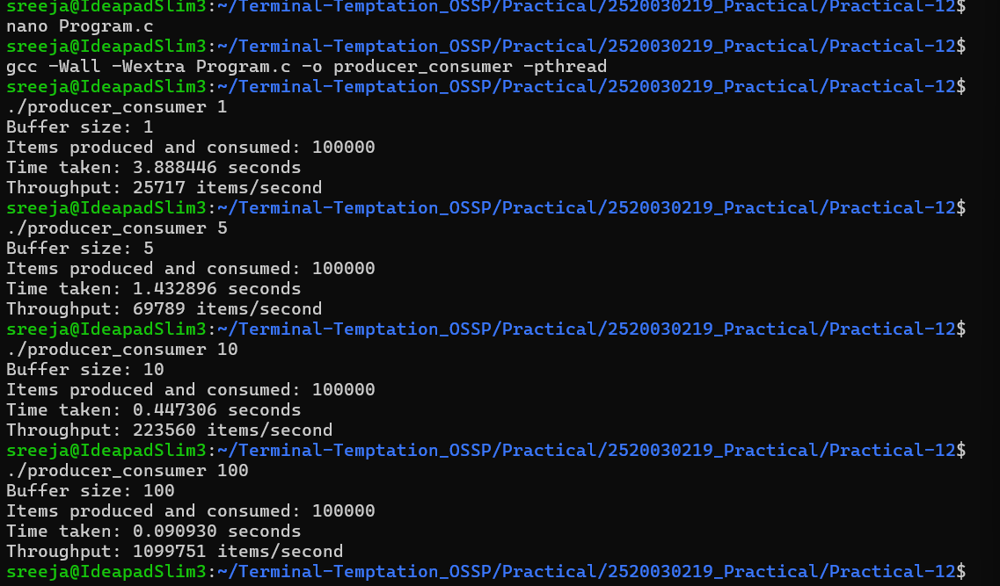

# Practical 12: Producer–Consumer and Deadlock Prevention

## 1. Aim
- Implement the Producer–Consumer problem using POSIX threads and counting semaphores.
- Evaluate synchronization correctness and throughput for different buffer sizes.
- Demonstrate deadlock and prevent it using resource ordering.

## 2. Producer–Consumer Implementation

The program uses:
- `empty`: Counts available buffer slots.
- `full`: Counts occupied buffer slots.
- `mutex`: Protects the shared buffer.
- `pthread_create()` and `pthread_join()` to manage threads.

## 3. Experimental Results

Each test produced and consumed 100,000 items successfully.

| Buffer Size | Time (seconds) | Throughput (items/second) |
|---:|---:|---:|
| 1 | 3.888446 | 25,717 |
| 5 | 1.432896 | 69,789 |
| 10 | 0.447306 | 223,560 |
| 100 | 0.090930 | 1,099,751 |

### Analysis

Throughput increased with buffer size in these experiments. A larger buffer reduced the frequency of producer and consumer waiting, improving performance on this system. Actual measurements may vary depending on scheduling and system load.

All four tests successfully produced and consumed the expected 100,000 items.

## 4. Deadlock Demonstration

Two threads compete for two mutex resources:
- Thread 1 holds Resource 1 and waits for Resource 2.
- Thread 2 holds Resource 2 and waits for Resource 1.

This creates a deadlock because neither thread can proceed.

### Four Necessary Conditions for Deadlock

1. **Mutual exclusion:** A resource can be held by only one thread at a time.
2. **Hold and wait:** A thread holds one resource while waiting for another.
3. **No preemption:** Resources cannot be forcibly taken from their owners.
4. **Circular wait:** Threads form a cycle of waiting for resources.

## 5. Deadlock Prevention

The prevention program enforces a fixed resource order: Resource 1 must be acquired before Resource 2. This prevents circular wait and allows both threads to complete.

## 6. Result

The Producer–Consumer problem was implemented successfully using POSIX threads and semaphores. Throughput was measured at four buffer sizes. Deadlock was demonstrated and prevented using resource ordering.

## Execution Screenshot

