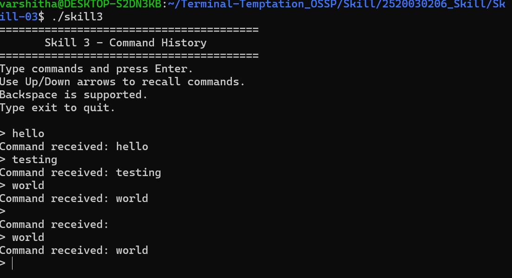
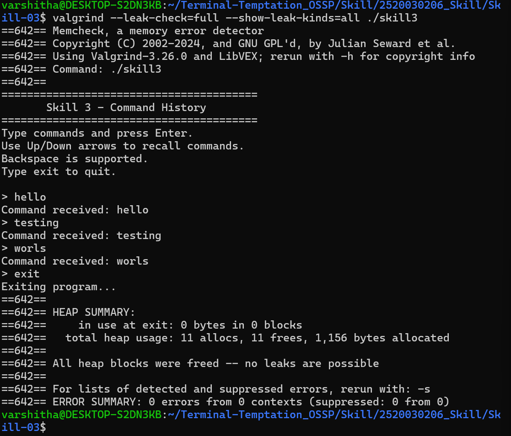

# Skill-03: Command History and Dynamic Memory Management

## Aim
To implement command-line input handling with escape sequences, command history, Up/Down arrow navigation, dynamic buffer resizing, and proper memory management using a linked list.

## Objectives
- Handle keyboard escape sequences.
- Store previously entered commands in a linked list.
- Navigate previous commands using the Up Arrow.
- Navigate forward through command history using the Down Arrow.
- Update the input buffer when a command is recalled.
- Dynamically resize the input buffer using `realloc()`.
- Prevent input buffer overflow.
- Release dynamically allocated memory correctly.
- Verify memory management using Valgrind.

## Technologies Used
- Language: C
- Environment: Ubuntu on WSL
- Compiler: GCC
- Memory checker: Valgrind

## Files
- `skill3.c` — source code for the command history program.
- `Screenshot1.png` — command history and input testing.
- `Screenshot2.png` — Valgrind memory-check results.

## Implementation
The program uses terminal settings from `termios.h` to read keyboard input without waiting for a complete line. It recognizes Enter, Backspace, and the Up/Down arrow escape sequences.

Commands are stored in a singly linked list. The Up Arrow recalls the latest command first, while the Down Arrow navigates toward newer entries and clears the input after the latest command is reached.

The input buffer is allocated dynamically using `malloc()`. When the input exceeds its current capacity, `realloc()` increases the buffer size. The program uses `free()` to release the input buffer and history nodes before exiting.

## Compilation
```bash
gcc -g -Wall -Wextra skill3.c -o skill3
```

## Execution
```bash
./skill3
```

## Testing
The following tests were performed:
1. Entered multiple commands and checked that they were stored.
2. Used the Up Arrow to recall commands in reverse chronological order.
3. Used the Down Arrow to navigate forward through history.
4. Checked that the input clears after navigating beyond the newest command.
5. Entered a long command to test dynamic buffer resizing.
6. Tested exiting the program and freeing allocated memory.

## Valgrind Memory Test
Command used:
```bash
valgrind --leak-check=full --show-leak-kinds=all ./skill3
```

Observed results:
- Total heap usage: 11 allocations and 11 frees.
- Memory in use at exit: 0 bytes in 0 blocks.
- All heap blocks were freed.
- Error summary: 0 errors.

These results confirm that the tested execution released all allocated heap memory without reported memory errors.

## Screenshots

### Screenshot 1: Command History and Input Testing


### Screenshot 2: Valgrind Memory Verification


## Result
The command history program was implemented and tested successfully. It supports escape-sequence handling, command recall, dynamic input buffer resizing, linked-list-based history storage, and memory cleanup verified using Valgrind.
