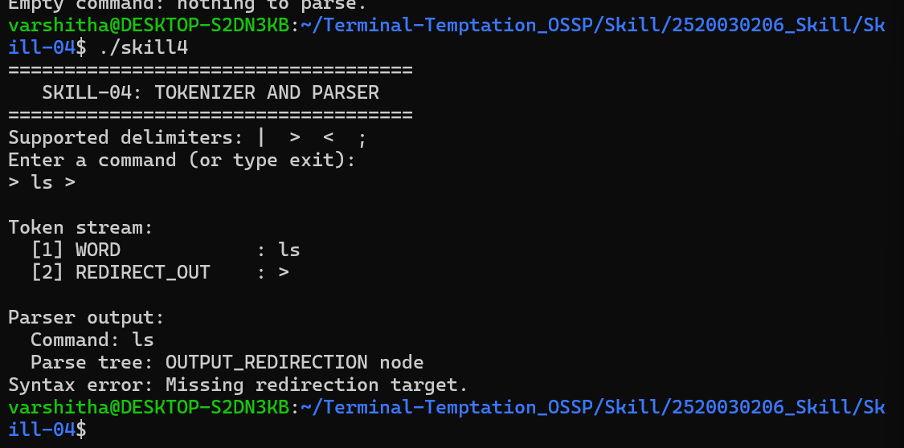
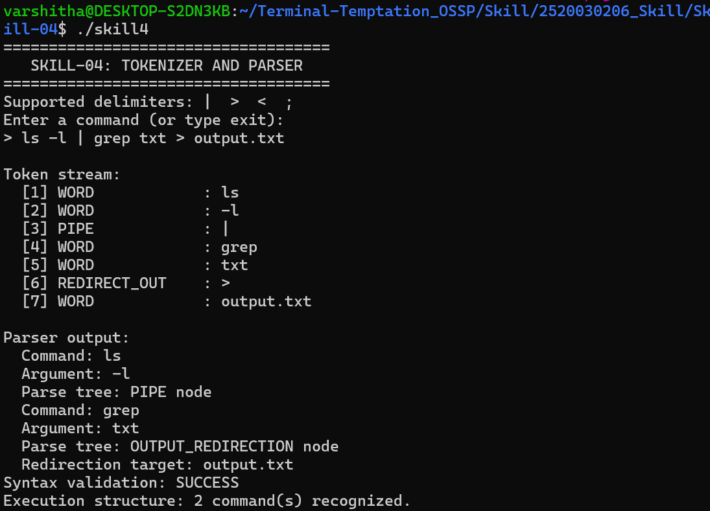

# Skill-04: Tokenizer and Parser Design

## 1. Objective

To design and implement a basic tokenizer and parser in C that splits user input into tokens, identifies delimiters, handles whitespace, validates token sequences, detects syntax errors, handles empty commands, and produces a basic representation of the command structure.

## 2. Tools and Technologies

- **Programming Language:** C
- **Operating System:** Ubuntu Linux (WSL)
- **Compiler:** GCC
- **Editor:** GNU nano

## 3. Concepts Implemented

1. **Tokenization:** Splits input into individual tokens.
2. **Delimiter Identification:** Recognizes pipe (`|`), output redirection (`>`), input redirection (`<`), and command separator (`;`).
3. **Whitespace Handling:** Ignores unnecessary spaces and tabs between tokens.
4. **Token Structures:** Uses a C structure to store each token's type and value.
5. **Token Stream Validation:** Checks whether tokens follow basic command syntax rules.
6. **Parser Output:** Identifies commands, arguments, and redirection targets.
7. **Syntax Error Detection:** Detects unexpected pipes, missing redirection targets, and invalid command endings.
8. **Empty Command Handling:** Detects empty input and reports that there is nothing to parse.
9. **Basic Parse Representation:** Displays labels for pipe, redirection, and sequence nodes.
10. **Execution Structure:** Reports the number of commands recognized by the parser.

## 4. Algorithm

1. Start the program.
2. Read a command from the user.
3. Check whether the input is empty or the user entered `exit`.
4. Scan the input character by character.
5. Skip whitespace and identify delimiters.
6. Create tokens and store their types and values in a token array.
7. Display the generated token stream.
8. Pass the tokens to the parser.
9. Identify commands, arguments, and redirection targets.
10. Validate the token sequence and detect syntax errors.
11. Display the parser output and validation result.
12. Stop the program.

## 5. Compilation and Execution

Compile the program using:

```bash
gcc -Wall -Wextra -std=c11 skill4.c -o skill4
```

Run the program:

```bash
./skill4
```

## 6. Test Cases

| Test Input | Expected Result |
|---|---|
| `ls -l \| grep txt > output.txt` | Tokens are identified and syntax validation succeeds |
| `   ls     -l   \|   grep txt` | Extra whitespace is ignored |
| `\| ls` | Unexpected pipe error |
| `ls >` | Missing redirection target error |
| Empty input | Empty command message |
| `ls ;` | Invalid command ending error |

## 7. Output Screenshots

### Screenshot 1: Syntax Error Detection

This screenshot demonstrates how the parser detects a missing filename after the output redirection operator (`>`).



### Screenshot 2: Successful Tokenization and Parsing

This screenshot demonstrates token generation, command recognition, parser output, and successful syntax validation for a valid input.



## 8. Result

The program demonstrates the basic working of a tokenizer and parser in C. It recognizes supported delimiters, creates token structures, handles whitespace, identifies commands and arguments, and detects several syntax errors. It also provides a basic parse-node display and reports the number of recognized commands.

**Note:** This is an educational parser for a limited command syntax. It does not execute the entered commands or implement a complete shell grammar.
