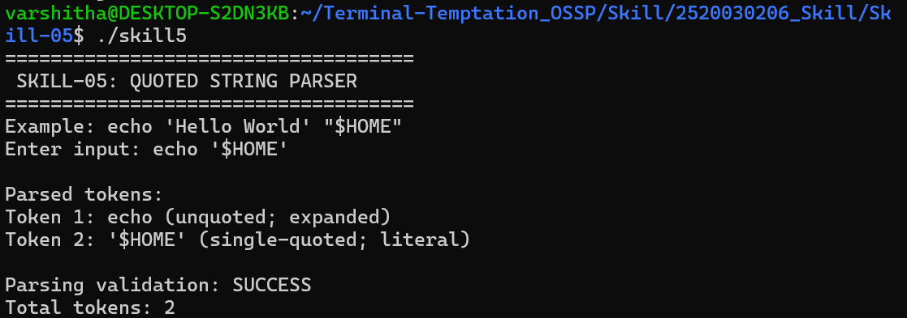
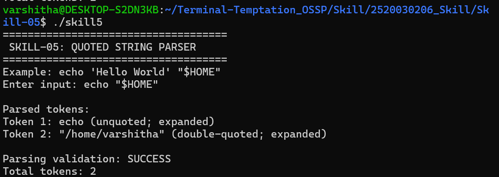

# Skill-05: Quoted String Parser

## Objective
To implement a simple quoted-string parser in C that demonstrates how single quotes preserve literal content and how double quotes allow environment-variable expansion. The program also preserves spaces within quoted strings, validates parsing results, and tests edge cases.

## Concepts Covered
- Single quotes preserve literal content.
- Double quotes allow variable expansion.
- Spaces inside quotes are preserved as part of one token.
- Unclosed quotes are detected as syntax errors.
- Parsing results and token counts are validated.

## Requirements
- C compiler (`gcc`)
- Linux or Ubuntu environment

## Compilation
```bash
gcc -Wall -Wextra -std=c11 skill5.c -o skill5
```

## Execution
```bash
./skill5
```

## Algorithm
1. Read a command string from the user.
2. Skip whitespace between tokens.
3. Identify single-quoted and double-quoted strings.
4. Preserve spaces within quoted strings.
5. Keep variables inside single quotes literal.
6. Expand environment variables inside double-quoted and unquoted tokens.
7. Detect unclosed quotes and invalid input.
8. Display the parsed tokens and validation result.

## Test Cases

| Test input | Expected result |
|---|---|
| `echo '$HOME'` | `$HOME` remains literal |
| `echo "$HOME"` | `$HOME` expands to the home directory |
| `echo "hello world"` | The quoted text remains one token |
| `echo "hello` | An unclosed-quote error is reported |

## Screenshot 1: Single Quotes Preserve Literal Content



## Screenshot 2: Double Quotes Allow Variable Expansion



## Result
The quoted-string parser was implemented and tested successfully. It preserves literal content inside single quotes, performs basic environment-variable expansion inside double quotes and unquoted tokens, preserves spaces within quoted strings, and detects unclosed quotes.

**Note:** This is an educational parser demonstrating basic quoting rules, not a complete shell parser.
