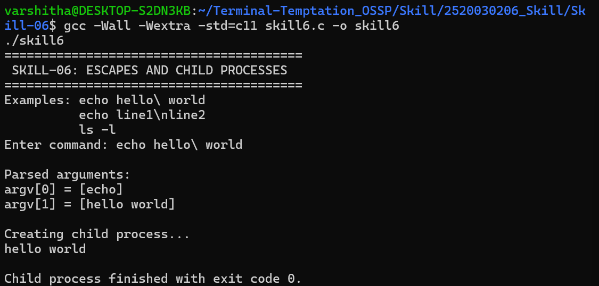
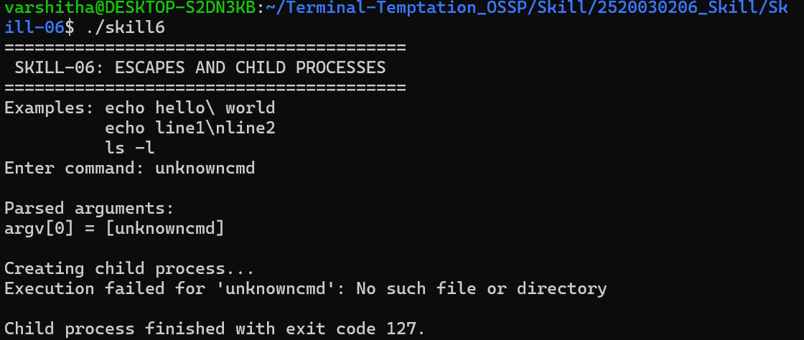

# Skill-06: Escape Sequences and Child Processes

## Objective
To implement a C program that handles escape sequences and escaped spaces, parses command-line arguments, creates a child process using `fork()`, executes programs using `execvp()`, and manages the child process using `waitpid()`.

## Concepts Covered
- Handling escaped spaces and special characters
- Processing escape sequences such as `\n` and `\t`
- Preserving escaped characters during parsing
- Validating parsed arguments
- Creating child processes using `fork()`
- Executing programs with arguments using `execvp()`
- Handling execution errors
- Managing child-process completion with `waitpid()`

## Requirements
- Ubuntu/Linux environment
- GCC compiler

## Compilation
```bash
gcc -Wall -Wextra -std=c11 skill6.c -o skill6
```

## Execution
```bash
./skill6
```

## Algorithm
1. Read a command from the user.
2. Parse the command into arguments.
3. Handle escaped spaces and supported escape sequences.
4. Display the parsed arguments for validation.
5. Create a child process using `fork()`.
6. Execute the requested program in the child using `execvp()`.
7. Report an error if execution fails.
8. Wait for the child process to finish and display its exit status.

## Test Cases

| Input | Purpose | Expected result |
|---|---|---|
| `echo hello\ world` | Escaped-space handling | `hello world` is passed as one argument |
| `echo hello` | Child process execution | Prints `hello`; exit code 0 |
| `ls -l` | Argument passing | Lists directory contents |
| `unknowncmd` | Execution-error handling | Reports an error; exit code 127 |

## Screenshot 1: Escaped Space and Successful Execution



## Screenshot 2: Execution Error Handling



## Result
The program demonstrates basic escape-sequence processing, command argument parsing, child-process creation, program execution, error reporting, and parent-process synchronization.

**Note:** This is an educational command parser, not a complete shell. It supports only the escape handling implemented in the source code.
