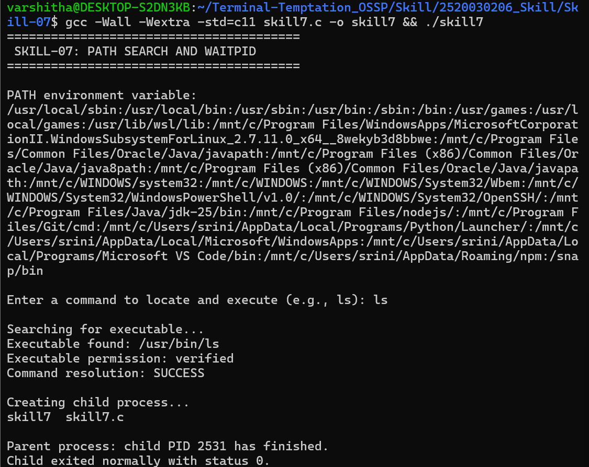
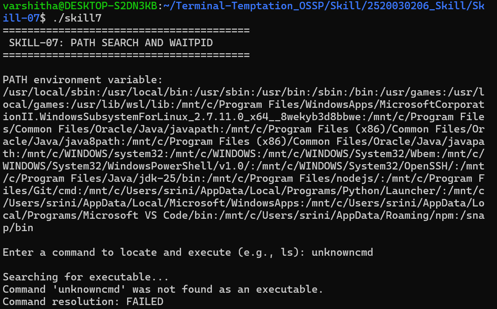

# Skill-07: PATH Search and Child Process Monitoring

## Objective
To develop a C program that retrieves the `PATH` environment variable, searches directories for executable commands, verifies executable permissions, handles missing commands, and monitors child-process completion using `waitpid()`.

## Concepts Covered
- Retrieving environment variables using `getenv()`
- Parsing PATH directories
- Locating executable files
- Verifying file types and execute permissions
- Handling commands that cannot be found
- Creating a child process using `fork()`
- Executing programs using `execv()`
- Synchronizing the parent process using `waitpid()`
- Checking child exit status

## Requirements
- Ubuntu/Linux environment
- GCC compiler

## Compilation
```bash
gcc -Wall -Wextra -std=c11 skill7.c -o skill7
```

## Execution
```bash
./skill7
```

## Algorithm
1. Retrieve and display the `PATH` environment variable.
2. Read a command from the user.
3. Search PATH directories for the requested executable.
4. Verify that the candidate is a regular file with execute permission.
5. Report an error if no executable is found.
6. Create a child process using `fork()`.
7. Execute the located program in the child process.
8. Use `waitpid()` in the parent process to wait for the child.
9. Display the child's exit status or termination signal.

## Test Cases

| Input | Purpose | Expected result |
|---|---|---|
| `ls` | PATH search and execution | Finds `/usr/bin/ls` and exits successfully |
| `pwd` | Resolve another executable | Locates and runs `pwd` |
| `unknowncmd` | Missing-command handling | Reports that the command was not found |
| `/bin/echo` | Explicit executable path | Verifies and executes the specified path |

## Screenshot 1: PATH Resolution and Successful Execution



## Screenshot 2: Missing Command Handling



## Result
The program demonstrates basic PATH-based executable resolution, permission verification, missing-command handling, child-process creation, and parent-process synchronization with `waitpid()`.

**Note:** This is an educational command-resolution program. It executes the selected program without passing additional command-line arguments.
