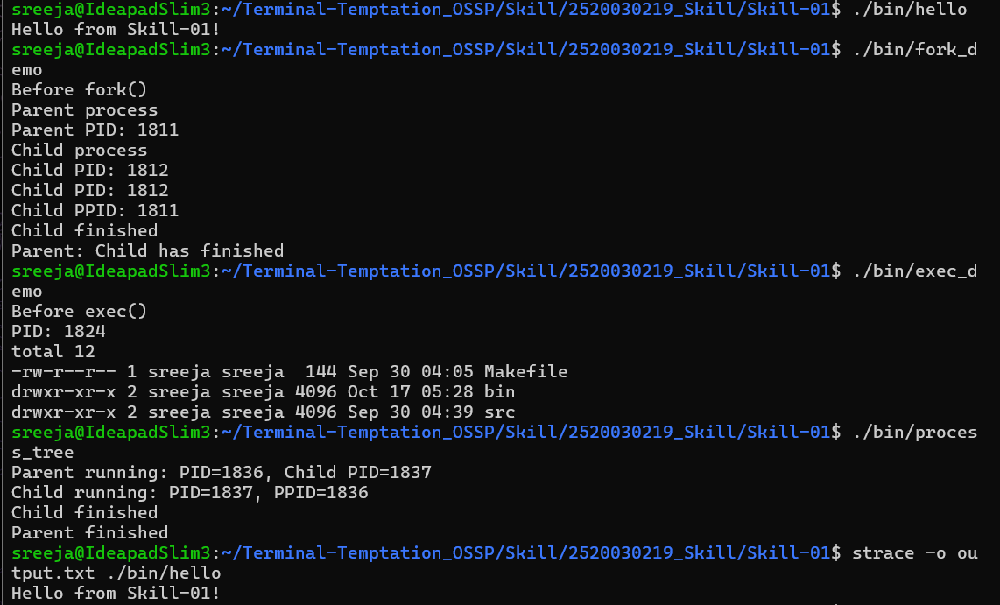

# Skill-01: Linux Setup and Process Management

## Aim
To configure the Linux development environment, compile C programs using GCC, understand process management, and trace system calls.

## Topics Covered
- Linux/Ubuntu environment and GCC setup
- Git repository and project structure
- Shell architecture
- `fork()` system call
- `exec()` family of functions
- Parent-child process relationships
- Process tree inspection
- System call tracing using `strace`
- Building programs using a Makefile

## Project Structure
```text
Skill-01/
├── Makefile
├── README.md
├── output.txt
├── skill1-execution.png
├── bin/
└── src/
    ├── hello.c
    ├── fork_demo.c
    ├── exec_demo.c
    └── process_tree.c
```

## Execution Commands
```bash
make
./bin/hello
./bin/fork_demo
./bin/exec_demo
./bin/process_tree
strace -o output.txt ./bin/hello
```

## Results
1. The hello program displayed its output successfully.
2. The fork demonstration created a child process and displayed process IDs.
3. The exec demonstration replaced the running program with another command.
4. The process-tree program displayed the parent PID and child PID.
5. The strace command recorded system calls made by the hello program.

## System Call Analysis
- `execve()` starts the executable.
- `openat()` opens files.
- `read()` reads data.
- `mmap()` maps memory.
- `write()` writes output to the terminal.
- `exit_group()` terminates the process.

The trace showed a successful write of `Hello from Skill-01!` and program termination with exit status 0.

## Screenshot Evidence


## Conclusion
The Linux development environment was used to compile and execute C programs demonstrating process creation, program execution, parent-child relationships, and system call tracing.
