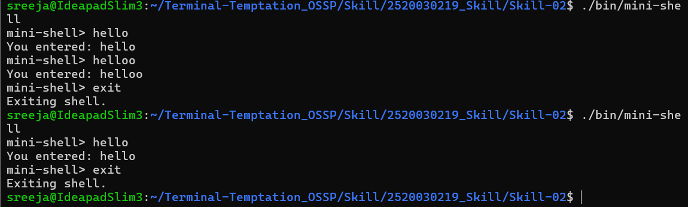

# Skill-02: Mini Shell

## Aim

To develop a basic interactive shell using C programming that accepts user input, handles keyboard input, and exits when the user enters the `exit` command.

## Project Structure

```text
Skill-02/
├── src/
│   ├── main.c
│   └── input.c
├── screenshots/
│   └── mini-shell.png
├── bin/
│   └── mini-shell
├── Makefile
└── README.md
```

## Description

This project implements a simple interactive mini shell in C. It displays a prompt, accepts input from the user, and prints the entered text. The shell continues running until the user enters `exit` or the input stream ends.

### Features

- Displays a custom `mini-shell>` prompt.
- Reads user input character by character.
- Supports Backspace for correcting input.
- Displays the entered command.
- Ignores empty input.
- Exits when the user enters `exit`.
- Uses a Makefile to compile the source files.

## Technologies Used

- C Programming
- Linux
- GCC Compiler
- Makefile
- POSIX terminal handling using `termios`

## Compilation

Navigate to the Skill-02 directory and compile the project:

```bash
make
```

The executable is generated at `bin/mini-shell`.

## Execution

Run the mini shell using:

```bash
./bin/mini-shell
```

## Sample Output

```text
mini-shell> hello
You entered: hello
mini-shell> helloo
You entered: helloo
mini-shell> exit
Exiting shell.
```

## Screenshot

The following screenshot shows the Mini Shell running in the Linux terminal.



## Learning Outcomes

- Understanding the structure of a basic interactive shell.
- Using functions to separate input handling from the main program.
- Reading and processing character input in C.
- Modifying terminal settings using `termios`.
- Compiling multiple C source files using GCC and Makefile.

## Limitations

This is a basic input-processing shell. It displays the text entered by the user but does not execute external Linux commands such as `ls` or `pwd`.


