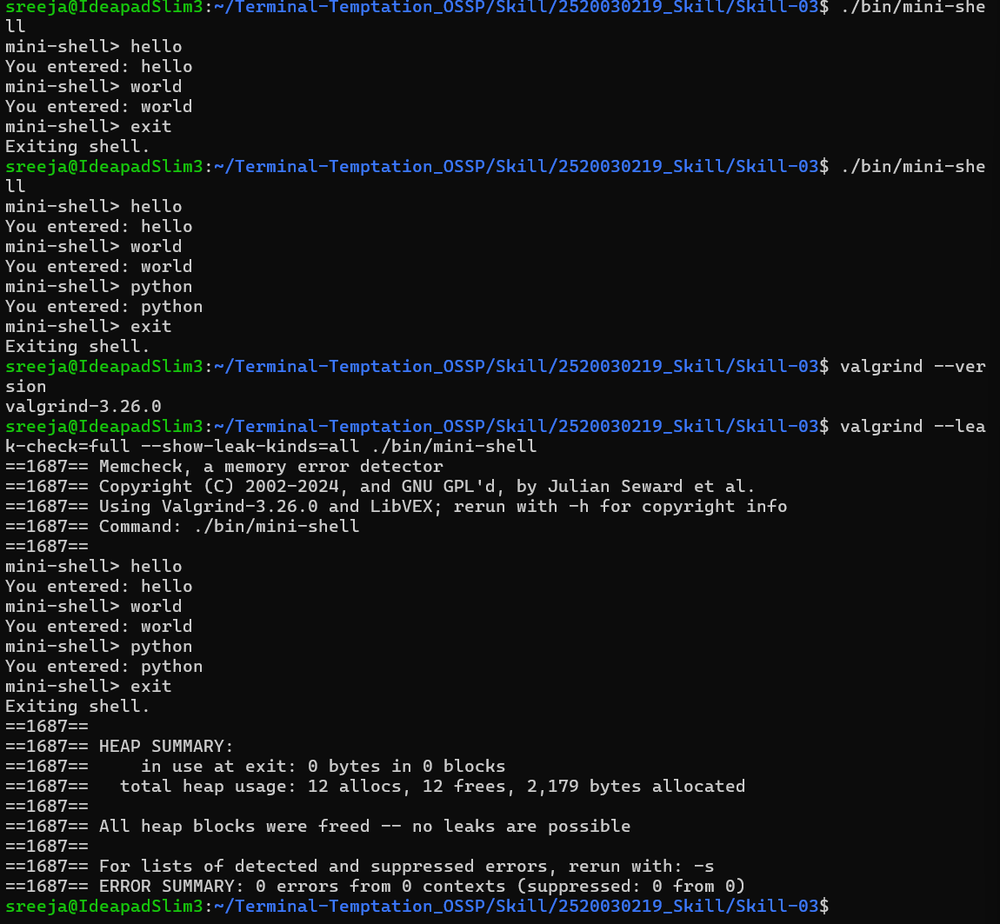

# Skill-03: Command History and Dynamic Memory Management

## Overview

This project extends a mini-shell with command history, keyboard navigation, dynamic input buffers, and linked-list-based memory management.

The shell allows users to enter commands, navigate previously entered commands using the Up and Down arrow keys, edit input using Backspace, and manage dynamically allocated memory safely.

## Features

- **Command History:** Stores previously entered commands in a linked list.
- **Up Arrow Navigation:** Recalls previous commands.
- **Down Arrow Navigation:** Moves forward through command history and returns to an empty input line.
- **Dynamic Input Buffer:** Uses `malloc()` and `realloc()` to allocate and resize the input buffer.
- **Input Editing:** Supports Backspace while typing.
- **Linked List Management:** Maintains command history using dynamically allocated nodes.
- **Memory Cleanup:** Releases allocated memory before the program exits.
- **Memory Testing:** Uses Valgrind to check for memory leaks and errors.

## Technologies Used

- C programming language
- Linux / Ubuntu (WSL)
- GCC compiler
- GNU Make
- Valgrind
- Git and GitHub

## Project Structure

```text
Skill-03/
├── src/
│   ├── main.c
│   ├── input.c
│   ├── input.h
│   ├── history.c
│   └── history.h
├── screenshots/
│   └── skill-03-valgrind.png
├── bin/
├── Makefile
├── README.md
└── .gitignore
```

## Requirements

- GCC compiler
- GNU Make
- Linux or Ubuntu environment
- Valgrind for memory testing

## Build Instructions

Compile the project using:

```bash
make
```

## Run the Mini-Shell

```bash
./bin/mini-shell
```

Example execution:

```text
mini-shell> hello
You entered: hello
mini-shell> world
You entered: world
mini-shell> exit
Exiting shell.
```

## Command History Testing

1. Run the mini-shell.
2. Enter several commands, such as `hello`, `world`, and `python`.
3. Press the **Up arrow key** to recall previous commands.
4. Press the **Down arrow key** to navigate forward through the history.
5. Press Enter to submit a recalled command.
6. Enter `exit` to close the shell.

Command history is maintained during the current shell session.

## Memory Management

The project uses the following memory management functions:

| Function | Purpose |
|---|---|
| `malloc()` | Allocates memory for the input buffer and history nodes. |
| `realloc()` | Resizes the input buffer when more space is required. |
| `strcpy()` / `memcpy()` | Copies command text into allocated buffers. |
| `free()` | Releases dynamically allocated memory. |
| `free_history()` | Frees history nodes and their command strings. |

## Memory Testing with Valgrind

Run the following command to check for memory leaks and errors:

```bash
valgrind --leak-check=full --show-leak-kinds=all ./bin/mini-shell
```

### Valgrind Results

The mini-shell was tested by entering multiple commands and exiting normally.

- **Heap memory in use at exit:** 0 bytes in 0 blocks
- **Total heap allocations:** 12
- **Total heap frees:** 12
- **Memory leaks:** None detected
- **Memory errors:** 0 errors from 0 contexts

Valgrind reported:

```text
All heap blocks were freed -- no leaks are possible
ERROR SUMMARY: 0 errors from 0 contexts
```

## Screenshot Evidence

### Mini-Shell Execution and Valgrind Memory Test

The screenshot below demonstrates successful command execution and memory verification using Valgrind. It shows the shell processing commands and exiting with no memory leaks or memory errors.



## Learning Outcomes

- Handling keyboard input and ANSI escape sequences.
- Implementing command history using a linked list.
- Managing dynamically allocated buffers.
- Resizing buffers safely with `realloc()`.
- Preventing memory leaks through proper cleanup.
- Testing C programs with Valgrind.

## Conclusion

Skill-03 demonstrates command history, keyboard-based navigation, dynamic memory allocation, linked-list management, and memory debugging in C. The program successfully passed the Valgrind test with zero bytes remaining in use at exit and zero reported memory errors.
