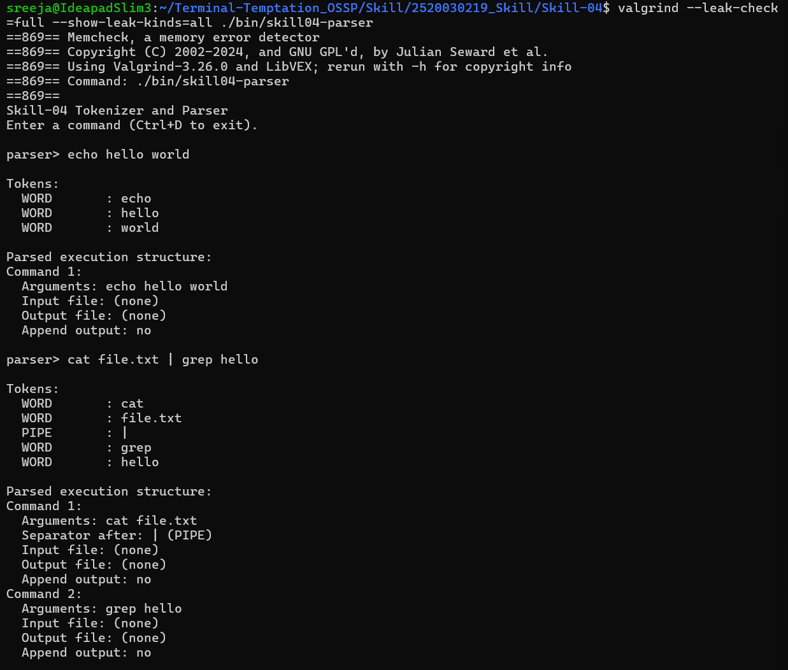
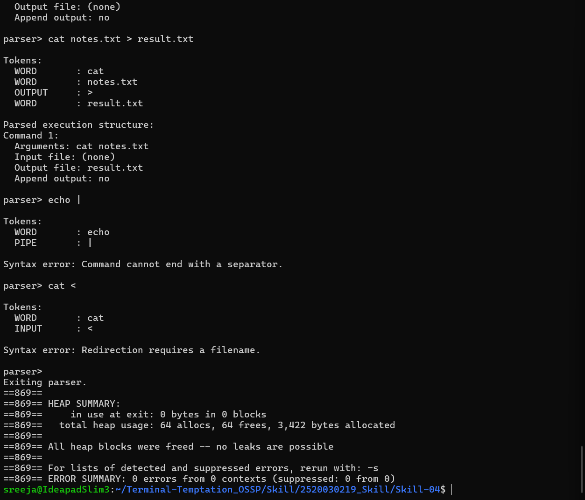

# Skill-04: Tokenizer and Parser

## Objective
Develop a tokenizer and parser for a mini-shell to split input into tokens, recognize operators, validate syntax, and generate command structures.

## Features
- Splits input into tokens.
- Handles whitespace and quoted text.
- Recognizes pipes (`|`) and semicolons (`;`).
- Supports input redirection (`<`).
- Supports output redirection (`>`).
- Supports append redirection (`>>`).
- Builds command argument structures.
- Preserves pipe and semicolon separators.
- Detects invalid syntax and missing filenames.
- Handles empty input.
- Frees dynamically allocated memory.

## Project Structure
```text
Skill-04/
├── src/
│   ├── main.c
│   ├── tokenizer.c
│   ├── tokenizer.h
│   ├── parser.c
│   └── parser.h
├── screenshots/
├── Makefile
├── .gitignore
└── README.md
```

## Build
```bash
make
```

## Run
```bash
./bin/skill04-parser
```

## Test Cases
| Input | Expected result |
|---|---|
| `echo hello world` | Three word tokens |
| `echo "hello world"` | Quoted text kept as one token |
| `cat file.txt \| grep hello` | Two commands connected by a pipe |
| `echo hello; pwd` | Two commands separated by a semicolon |
| `grep hello < input.txt` | Input redirection detected |
| `cat notes.txt > result.txt` | Output redirection detected |
| `echo hello >> output.txt` | Append redirection detected |
| `echo \|` | Syntax error |
| `cat <` | Missing filename error |
| Unclosed quote | Tokenization error |
| Empty input | Empty command message |

## Memory Validation
Tested with Valgrind using valid commands, redirection, pipes, and invalid syntax.

- Total allocations: 64
- Total frees: 64
- Memory in use at exit: 0 bytes
- Memory errors: 0

## Limitations
This project builds and validates command structures. It does not execute commands or implement actual pipes and file redirection.


## Screenshots

### 1. Tokenization and Parsing Tests

The screenshots show token generation, command parsing, pipe handling, output redirection, and invalid syntax detection.





### 2. Memory Validation with Valgrind

Valgrind verified that all allocated memory was freed successfully, with zero memory leaks and zero reported errors.
